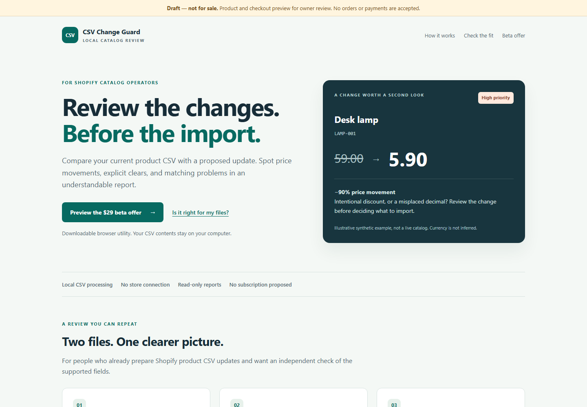
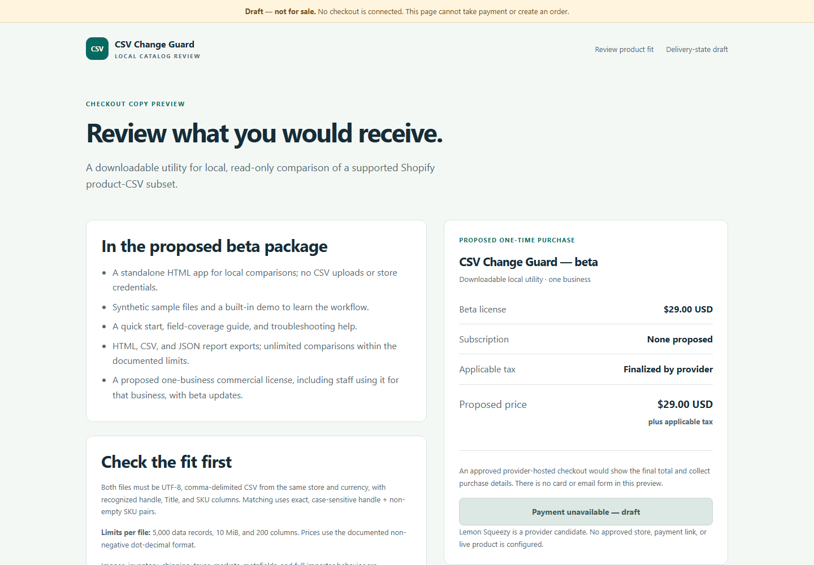

# Internal beta preparation validation — 21 October 2026

This is automated Windows evidence for an **internal, not-for-sale candidate**.
It does not verify checkout, provider delivery, paid demand or real merchant fit.
Earlier [manual owner confirmations](MANUAL_OWNER_VALIDATION.md) and
[in-app browser comparisons](SHOPIFY_EXPORT_VALIDATION.md) remain separate records.
No new manual owner confirmations or Codex in-app browser checks were performed here.

## Environment and scope

Windows 11 24H2, build 26100.9711; Node v24.12.0, npm 11.6.2;
Python 3.14.0 and Playwright 1.62.0 in the existing optional virtual environment.
Installed Google Chrome **155.0.8059.85** and Microsoft Edge **155.0.4283.62**
were launched as separate automated instances, with `chromium_sandbox=True`.
The actual command-line diagnostic was checked for absence of `--no-sandbox`.
No extension installation, browser security changes or CSP bypass was used.

The source base was `954ddefd08fae8f0362f92792b3cb3102c021289` plus the
paid-beta preparation changes in the associated PR. No comparison/interface source,
optional server or committed application build changed. Rebuilding on this Windows
checkout produced mixed line endings from existing source checkout conversion;
the LF-normalized app SHA-256 remains
`5d126e2a456f3b547cc87c6521eb628658a2071c531844bb0323136363d46c5d`,
identical to the base commit. The ZIP copies the rebuilt app bytes exactly.

## Commands actually run

From the repository root, before changes: `npm.cmd test` passed **106** tests.
After adding the package suite: `npm.cmd test` passed **112** tests, comprising
the original 106 engine/scenario tests and six new package tests. No assertions
were weakened. The committed-bundle diff and `git diff --check` also passed.

```powershell
npm.cmd run package:beta -- --output <fresh-output-parent>
Expand-Archive -LiteralPath <candidate.zip> -DestinationPath <fresh-extraction>

# Run separately for each installed browser by setting CHROMIUM_PATH.
python tests/browser_test.py --file <fresh-extraction>/CSV-Change-Guard/dist/index.html --artifacts-dir <fresh-results>

# In a separate terminal, from the extracted CSV-Change-Guard folder:
$env:PORT = '8092'
node server.cjs

# Again, once per installed browser:
python tests/browser_test.py --url http://127.0.0.1:8092/ --artifacts-dir <fresh-results>
python tests/beta_preview_test.py --package-dir <fresh-extraction>/CSV-Change-Guard --archive <candidate.zip> --artifacts-dir <fresh-results>
```

Angle-bracket paths above replace local output paths for portability; the actual
runs used fresh directories outside the checkout. The server was stopped after
testing. The preview runner also uses the optional Playwright environment; Python
and Node are not needed for a buyer's normal direct-file use.

## Observed results

| Check | Result |
|---|---|
| Windows PowerShell ZIP extraction | All 10 allowlisted/generated files extracted successfully |
| Independent Python ZIP/CRC reader | Payloads equal Windows extraction; manifest and all nine SHA256SUMS entries match |
| Allowlist and reproducibility | Six Node package tests pass, including extra-file exclusion, exact app bytes, identical archive output and refusal of existing/protected/linked inputs or destinations |
| Chrome, extracted file | 17/17 browser groups passed |
| Edge, extracted file | 17/17 browser groups passed |
| Chrome, copied localhost server | 17/17 browser groups passed |
| Edge, copied localhost server | 17/17 browser groups passed |
| Help + product/checkout/delivery drafts | Local navigation/styles/links and 1440px/390px layout checks passed in both installed browsers |
| Draft privacy/inertness | No forms or scripts; payment/download controls disabled; no HTTP requests or page/console errors observed |

The 17-group suite covers demo counts, settings invalidation, file selection,
clearing, malformed inputs, asynchronous cancellation, pagination, complete
exports and independent report reopening/layout. It reads repository synthetic
fixtures; the package manifest independently verifies byte-identical copies of
the three shipped CSV samples. This is automated selection, not a fresh human
Windows file-dialog test. It does not rerun every separate scenario manually.

The deliberately risky demo remains **4 compared, 4 price changes, 6 priority
findings, 4 unpaired update rows, 15 total findings**, with the incomplete
comparison verdict. File mode generated no application HTTP requests; localhost
mode observed only the initial requested document. Raw results preserve the
full group descriptions.

The first visual pass found lost inner padding on the checkout cards; that CSS
override was removed and final screenshots regenerated. Selected final screenshots were
visually inspected for readable text, spacing and draft labels. Preview checks
do not establish a complete accessibility audit, browser support matrix or
customer comprehension.

## Artifact identity and screenshots

Candidate: **0.1.0-beta.1**; app: **0.1.0**; status:
`internal-preview-not-for-sale`. ZIP: **96,591 bytes**, SHA-256:
`6c0224bd1487c0b897638ef97689a4e7d4fa2fb489a86ebeb99e7bff938c1277`.
Packaged app raw SHA-256:
`585ce2008f2bab0005f2ba2cc9b00c43cae1ffb3fb8d5c954e698a919e35e1b8`.
These hashes identify the Windows candidate; checkout line endings can change
future archive hashes without changing normalized app content.

The [curated evidence directory](../test-artifacts/beta-preparation-2026-10-21/)
contains results with machine paths redacted, final desktop/mobile screenshots,
the package manifest/checksum list and source/artifact digest inventory. Full raw
outputs and the internal ZIP remain local; the ZIP was not published as a
GitHub Release or uploaded to a payment provider.





[Mobile product draft](../test-artifacts/beta-preparation-2026-10-21/preview/chrome-product-mobile.png),
[offline help](../test-artifacts/beta-preparation-2026-10-21/preview/chrome-help-desktop.png),
[Edge checkout draft](../test-artifacts/beta-preparation-2026-10-21/preview/edge-checkout-desktop.png)
and [extracted app results](../test-artifacts/beta-preparation-2026-10-21/app/chrome-file-results.png)
provide additional views.

## Not run and next action

No real payment, provider test transaction, emailed receipt, hosted download,
refund, entitlement enforcement, live purchase-data privacy test, merchant-file
comparison or store import was performed. Draft success/failure pages are copy
previews, not evidence of those events. No product-site deployment, outreach, paid service
activation or repository licensing/visibility change occurred.

Next, run an unassisted synthetic trial with an intended user and record where
the package/help/report needs explanation. Final seller/support details and
terms are needed before the separately authorized provider test-mode rehearsal.
See [the complete remaining gates](PAID_BETA_PREPARATION.md).
