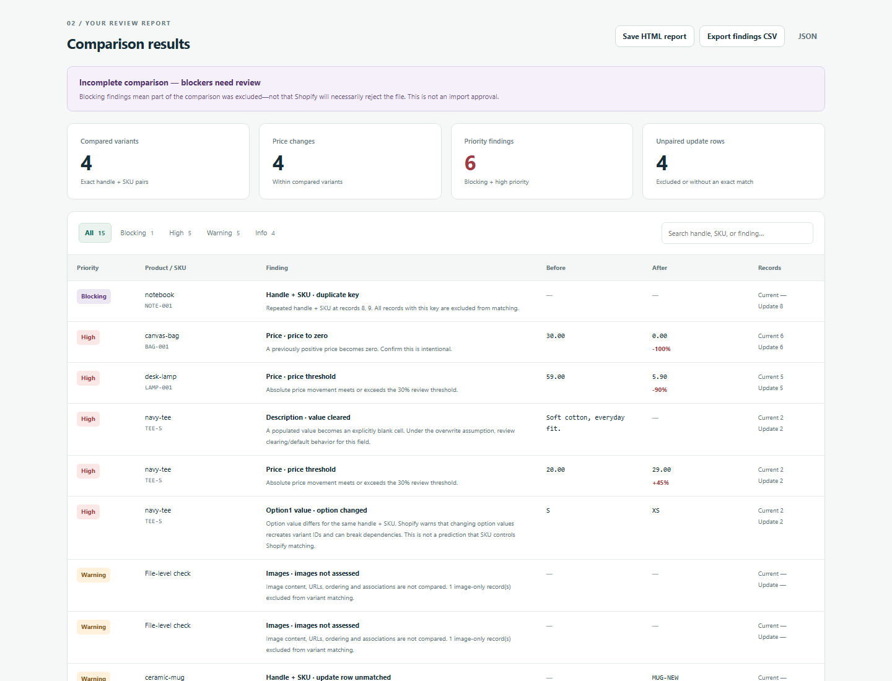

# Windows and Microsoft Edge validation

On **19 October 2026, 00:02:34–00:03:01 Europe/Warsaw (UTC+02:00)**,
the unchanged checkout at commit
[`fa49d64`](https://github.com/DemonazGH/csv-change-guard/commit/fa49d64f8f308c7f24398f1571e5b63a5534623c)
passed the automated checks below using synthetic files only. Evidence timestamps
use UTC, so their filenames and JSON dates begin with 18 October.

## Environment and results

| Item | Observed value |
|---|---|
| Operating system | Windows 11 Enterprise LTSC Evaluation, 64-bit, build 26100 |
| Installed Microsoft Edge | 155.0.4283.45 |
| Executable | `C:\Program Files (x86)\Microsoft\Edge\Application\msedge.exe` |
| Python / Playwright | 3.14.0 / 1.62.0, using the existing Python virtual environment |
| Node / npm | v24.12.0 / 11.6.2 |
| Execution | Separate headless Edge instances with temporary profiles |
| Sandbox | Enabled on every launch; no `--no-sandbox` argument |

| Executed check | Fresh result | Evidence |
|---|---|---|
| Engine and catalog scenarios | **106 passed**, zero failures/cancelled/skipped | [Node output](../test-artifacts/windows-edge-2026-10-19/engine-tests.txt) |
| Browser suite through actual `file://` navigation | **15/15 groups passed** | [File result](../test-artifacts/windows-edge-2026-10-19/browser/file-20261018T220241412941Z-0cdea452/browser-test-results.json) |
| Browser suite through actual localhost navigation | **15/15 groups passed** | [Localhost result](../test-artifacts/windows-edge-2026-10-19/browser/url-20261018T220249037539Z-8dd49650/browser-test-results.json) |
| Supplemental START_HERE workflow and nine scenarios | **9/9 grouped checks passed** | [Workflow result](../test-artifacts/windows-edge-2026-10-19/start-here/workflow-results.json) |
| Rebuild and checkout integrity | Passed; all **174 tracked files byte-identical** after testing | [Run summary](../test-artifacts/windows-edge-2026-10-19/run-summary.json), [build log](../test-artifacts/windows-edge-2026-10-19/build.txt) |

The maintained browser runner's JSON uses the generic engine labels `Chromium`
and `versions.chromium`. Its recorded executable path and version identify the
actual installed Edge used here. The runner itself was not changed.

Both browser routes exercised the demo, filters/search, HTML/CSV/JSON downloads,
full exports despite active filters, settings invalidation, overwrite disabled,
legacy/current headers, delimiter and UTF-8 rejection, clearing rejected names,
pending file/settings cancellation, the synthetic status/option compatibility
case, and the 390px layout. Neither route used `set_content` or a fallback.

No page JavaScript errors or unexpected application HTTP(S) requests were
observed. Localhost observed only the initial document navigation; file-mode
and supplemental app/report pages observed none. This does not describe all
Edge background traffic. The supplemental CDP command-line capture confirms
the absence of `--no-sandbox`; no browser policies or persistent settings changed.
Test browser instances and the loopback server were closed afterward.

## START_HERE.txt and scenario results

ZIP download/extraction and Explorer **Open with** were not repeated: this run
used the requested Git checkout and automated ordinary navigation. Native file
dialogs were not exercised; Playwright selected real synthetic files from disk.

- The built-in demo and exact `current-catalog.csv` / `proposed-update.csv` pair
  each produced **4 compared variants, 4 price changes, 6 priority findings,
  4 unpaired update rows, and 15 findings**. The incomplete verdict is expected.
- A fresh demo HTML download opened locally with 15 rows and coverage visible.
  A separate sample-pair HTML download opened after closing the app tab, with
  all 15 rows, filenames, settings, before/after values and limitations present.
  Neither exported report contained scripts.
- Clearing after both runs emptied file inputs and loaded names, removed
  findings/coverage/verdict/error content, hid results, and disabled Compare.
- All nine linked scenarios used `samples/scenarios/catalog.csv` as current,
  threshold 30%, and overwrite enabled. Their compared/price counts matched the
  [scenario contract](../samples/scenarios/README.md):

| Proposed update | Compared variants | Price changes |
|---|---:|---:|
| `catalog.csv` | 6 | 0 |
| `partial-prices.csv` | 2 | 2 |
| `explicit-clears.csv` | 6 | 0 |
| `reordered.csv` | 6 | 0 |
| `changed-identifiers.csv` | 3 | 0 |
| `invalid-identifiers.csv` | 2 | 0 |
| `duplicate-identifiers.csv` | 5 | 0 |
| `mixed-header-prices.csv` | 6 | 1 |
| `unusual-prices.csv` | 6 | 5 |

The browser scenario loop checks counts and absence of UI errors; the Node
scenario suite separately checks identities, values, exclusions and semantics.

## Screenshots and evidence



- [Demo](../test-artifacts/windows-edge-2026-10-19/start-here/demo-results.png), [selected files](../test-artifacts/windows-edge-2026-10-19/start-here/samples-selected.png), [cleared state](../test-artifacts/windows-edge-2026-10-19/start-here/cleared-after-samples.png).
- [Downloaded demo report](../test-artifacts/windows-edge-2026-10-19/start-here/demo-downloaded-report-open.png), [downloaded sample report](../test-artifacts/windows-edge-2026-10-19/start-here/downloaded-report-open.png), [full sample report](../test-artifacts/windows-edge-2026-10-19/start-here/downloaded-report-full.png).
- [Partial updates](../test-artifacts/windows-edge-2026-10-19/start-here/scenario-partial-prices.csv.png), [explicit clears](../test-artifacts/windows-edge-2026-10-19/start-here/scenario-explicit-clears.csv.png), [390px layout](../test-artifacts/windows-edge-2026-10-19/browser/file-20261018T220241412941Z-0cdea452/mobile.png).

The [evidence directory](../test-artifacts/windows-edge-2026-10-19/) contains
23 fresh screenshots, synthetic exports, results, logs and script snapshots.
Selected screenshot review confirmed the visible metrics, selected/cleared
states and report contents. Exported report columns still wrap identifiers and
finding codes narrowly, as in the prior Chrome evidence; content remains present.
This run does not establish that a human finds the report understandable.

The [artifact manifest](../test-artifacts/windows-edge-2026-10-19/artifact-manifest.json)
records original and published SHA-256 values. Machine-specific metadata and
script paths and text-log newlines are normalized. Screenshots and exports retain
their original bytes. A directory-scoped `.gitattributes` preserves evidence bytes
across checkouts and recognizes the CSV exports' CRLF separators.
Archived `.py.txt` files document the executed assertions;
they are evidence snapshots, not new maintained test commands.

## Reproduction and build integrity

The existing virtual environment already contained the pinned browser test
dependency; no application dependencies or browser downloads were needed.
Commands executed from the repository root included:

```powershell
npm.cmd test
$env:CHROMIUM_PATH = 'C:\Program Files (x86)\Microsoft\Edge\Application\msedge.exe'
# Use the prepared Python virtual-environment interpreter:
python tests/browser_test.py --file --artifacts-dir <fresh-artifacts-directory>
# With node server.cjs running on 127.0.0.1:52691 (PORT=52691):
python tests/browser_test.py --url http://127.0.0.1:52691/ --artifacts-dir <fresh-artifacts-directory>
python <captured-supplemental-workflow-script>
npm.cmd run build
```

The [driver snapshot](../test-artifacts/windows-edge-2026-10-19/validation_driver.py.txt)
records server startup/cleanup, commands and integrity checks; the
[supplemental snapshot](../test-artifacts/windows-edge-2026-10-19/start_here_test.py.txt)
records the additional assertions. Do not disable sandboxing to reproduce.

The rebuild produced 63,145 bytes with Windows checkout line endings. It matched
the tested bundle after CRLF/LF normalization; the original checkout bytes were
restored. Git status was clean before evidence/docs were added. Tested bundle
SHA-256: `6671736080fde8ccf9c1e2225c49c3a787f6fc51b435ef21c5d9d2cfe10e5f54`.
Application sources, generated bundle, fixtures, tests, dependencies and CI
configuration remain unchanged in this documentation update.

## Remaining validation

This closes automated compatibility for this installed Edge version on Windows,
through file and localhost navigation. Manual Explorer/native file-dialog use,
owner report comprehension, other browser versions, larger/adversarial browser
inputs, representative merchant workflows and controlled Shopify import
comparisons remain separate checks. No merchant files, Shopify connection,
import, payment or deployment was involved. No findings is not import approval.

The next small step remains a manual owner smoke test with the same synthetic
files, recording confusing steps and whether the saved report explains the
findings without assistance.
