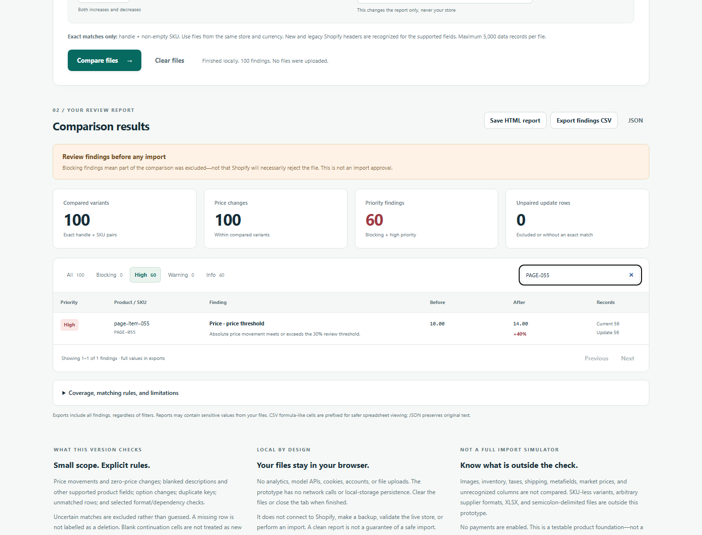

# Synthetic pagination and complete-export validation

On **20 October 2026, 23:44:34–23:45:04 Europe/Warsaw (UTC+02:00)**,
automated Windows tests passed against the unchanged application at base commit
[`5a7480b`](https://github.com/DemonazGH/csv-change-guard/commit/5a7480b6f19c634195412e748144a6700ba875df),
using the new browser test code captured in the evidence. No application defect
was found. Source, bundle, dependencies, workflow and existing fixtures are unchanged.

These are **automated results**, separate from the owner's earlier
[guided manual confirmations](MANUAL_OWNER_VALIDATION.md).

## Independent synthetic contract

`tests/browser_pagination.py` constructs two CSVs with 100 invented products,
one variant per product, unchanged handle/SKU pairs and complete Option1 pairs.
It generates expected findings directly from the fixture definition, without
asking the comparison engine to supply the expected results.

| Synthetic identifiers | Before | After | Expected finding |
|---|---|---|---|
| `PAGE-001` through `PAGE-060` | 10.00 | 14.00 | 60 high-priority `PRICE_THRESHOLD` findings, +40% |
| `PAGE-061` through `PAGE-100` | 10.00 | 11.00 | 40 informational `PRICE_CHANGED` findings, +10% |

At threshold 30% with overwrite enabled, each comparison must produce
**100 compared variants, 100 price changes, 60 priority findings, zero unpaired
rows, and 100 total findings**. There are no blocking or warning findings in
this deliberately small schema. Fields outside it remain outside coverage;
the fixture does not test full Shopify CSV compatibility.

The new group verifies:

1. All 100 expected identities in exact order over **40 / 40 / 20** rows, without
   missing or duplicated findings; Previous navigation and disabled end buttons.
2. Search applied on the last page resets to the first matching page. Ten-match,
   no-match and cleared searches have the correct bounds and button states.
3. High, Info and All filters applied from later pages reset pagination correctly,
   including a 60-result high-priority view with a second page of 20 rows.
4. With High active and search `PAGE-055` showing **one row**, HTML, CSV and JSON
   downloads still contain the **complete 100-finding report**. Exporting retains
   the active view. CSV and JSON identities, exact before/after values, severity,
   codes, percentages and record numbers are checked against the independent list.
5. After closing the comparison context, the downloaded HTML opens by `file://`
   in a fresh context. All 100 rows, identities, before/after values, severity,
   codes, percentages and coverage heading are present, with no scripts.

## Fresh Windows results

Environment: Windows 11 Enterprise LTSC Evaluation, Version 24H2, build
**26100.9711**; Node **24.12.0**, npm **11.6.2**, Python **3.14.0** and pinned
Playwright **1.62.0** in the existing virtual environment. Browser versions below
are those returned by the running browsers, not inferred from executable metadata.

| Installed browser | Navigation | Browser groups | Pagination result |
|---|---|---|---|
| Chrome 155.0.8059.85 | File | **16/16 passed** | [Result](../test-artifacts/pagination-2026-10-20/chrome/file/file-20261020T214436550324Z-cd80d118/pagination/pagination-results.json) |
| Chrome 155.0.8059.85 | Localhost | **16/16 passed** | [Result](../test-artifacts/pagination-2026-10-20/chrome/localhost/url-20261020T214443969457Z-9524fd54/pagination/pagination-results.json) |
| Edge 155.0.4283.62 | File | **16/16 passed** | [Result](../test-artifacts/pagination-2026-10-20/edge/file/file-20261020T214450991501Z-0bed23be/pagination/pagination-results.json) |
| Edge 155.0.4283.62 | Localhost | **16/16 passed** | [Result](../test-artifacts/pagination-2026-10-20/edge/localhost/url-20261020T214458028173Z-36c6d994/pagination/pagination-results.json) |

All existing 15 browser groups remain; the pagination/export group increases
the total to 16. The suite still exercises demo, filters, original downloads,
file selection, settings, invalid files, cancellation, clearing, compatibility
regressions and narrow layout. [Node tests](../test-artifacts/pagination-2026-10-20/engine-tests.txt)
passed **106/106** before and after adding the browser coverage; the published
log is the final run.

Chromium sandboxing was enabled on every launch. The runner now records the
actual browser command line and checks that `--no-sandbox` agrees with the
explicit opt-out argument; every Windows run here had that argument absent.
`--enable-automation` enables that diagnostic capture and does not disable
sandboxing or bypass CSP. Locator assertions remain CSP-safe.

During test development, the first command-line capture attempt failed before
any groups ran because Chrome requires `--enable-automation` for that CDP call.
The [failed setup result](../test-artifacts/pagination-2026-10-20/development-launch-audit-failure.json)
is retained separately. Adding the diagnostic flag corrected the test setup;
the four successful runs above are fresh runs after that correction.

No page JavaScript errors or unexpected application/report HTTP(S) requests were
observed. The original suite and the isolated pagination context each navigate
once to the application document in localhost mode; file-mode and standalone
reports issue no HTTP(S) requests. Separate temporary profiles were used, and
all test browsers and the loopback server were stopped afterward. This is not
a measurement of every browser background request.

A separate sandboxed Chrome `--content` run passed **16/16** at
23:45:10–23:45:16. Its [result](../test-artifacts/pagination-2026-10-20/content-mode/browser-test-results.json)
and [pagination result](../test-artifacts/pagination-2026-10-20/content-mode/pagination-results.json)
explicitly identify in-memory rendering, including the HTML report check.
It is not file-navigation evidence or a fallback for a failed navigation run.

## Screenshots and reproduction



- [Chrome page 1](../test-artifacts/pagination-2026-10-20/chrome/file/file-20261020T214436550324Z-cd80d118/pagination/page-1.png) and [page 3 showing 81–100](../test-artifacts/pagination-2026-10-20/chrome/file/file-20261020T214436550324Z-cd80d118/pagination/page-3.png).
- [Edge downloaded report](../test-artifacts/pagination-2026-10-20/edge/localhost/url-20261020T214458028173Z-36c6d994/pagination/report-open.png) and [last finding with coverage](../test-artifacts/pagination-2026-10-20/edge/localhost/url-20261020T214458028173Z-36c6d994/pagination/report-last-finding.png).
- Reusable generated [current CSV](../test-artifacts/pagination-2026-10-20/chrome/file/file-20261020T214436550324Z-cd80d118/pagination/current.csv), [proposed CSV](../test-artifacts/pagination-2026-10-20/chrome/file/file-20261020T214436550324Z-cd80d118/pagination/proposed.csv), and [expected findings](../test-artifacts/pagination-2026-10-20/chrome/file/file-20261020T214436550324Z-cd80d118/pagination/expected-findings.json).

The [evidence directory](../test-artifacts/pagination-2026-10-20/) contains
32 fresh screenshots, complete exports, generated fixtures, results and test
snapshots. Selected screenshot review confirmed the final page, filtered view,
standalone report and final finding. Metadata/script paths and text-log newlines
are normalized; screenshots, CSVs and exported HTML/JSON retain their bytes.
The [manifest](../test-artifacts/pagination-2026-10-20/artifact-manifest.json)
records original and published hashes. Directory-scoped Git attributes preserve
evidence bytes and recognize CSV CRLF separators.

```powershell
npm.cmd test
$env:CHROMIUM_PATH = 'C:\Program Files\Google\Chrome\Application\chrome.exe'
# Use the prepared Python virtual-environment interpreter:
python tests/browser_test.py --file --artifacts-dir <fresh-directory>
# Start node server.cjs with PORT=52700 in another terminal, then:
python tests/browser_test.py --url http://127.0.0.1:52700/ --artifacts-dir <fresh-directory>
# Repeat both routes with CHROMIUM_PATH set to installed msedge.exe.
```

The [run summary](../test-artifacts/pagination-2026-10-20/run-summary.json)
and [driver snapshot](../test-artifacts/pagination-2026-10-20/validation_driver.py.txt)
record actual commands, the dynamically selected port, source/test hashes and
cleanup. The maintained entry point remains `tests/browser_test.py`; generated
CSVs and expected values are written to each fresh run directory automatically.

All tracked files were byte-identical before/after the final four-route run,
including the already-modified test runner. Application sources and the bundle
also have no diff from the base commit. No rebuild was needed for this test-only
change; CI separately verifies the committed build. Tested bundle SHA-256:
`6671736080fde8ccf9c1e2225c49c3a787f6fc51b435ef21c5d9d2cfe10e5f54`.

## Limits and next step

This verifies a 100-change browser report, not worst-case performance at the
5,000-record/10 MiB limits, adversarial rendering, a broad browser matrix,
merchant usefulness or Shopify importer behavior. It does not add manual owner
confirmations. No Shopify account was accessed, no store connection or import
was made, and no product deployment or payment was involved.

The next bounded validation can use synthetic products in an explicitly
authorized test store to obtain Shopify-generated exports. A controlled import
comparison would be a separate, explicitly authorized task. CSV Change Guard
itself remains local and read-only and requires no store credentials or API key.
