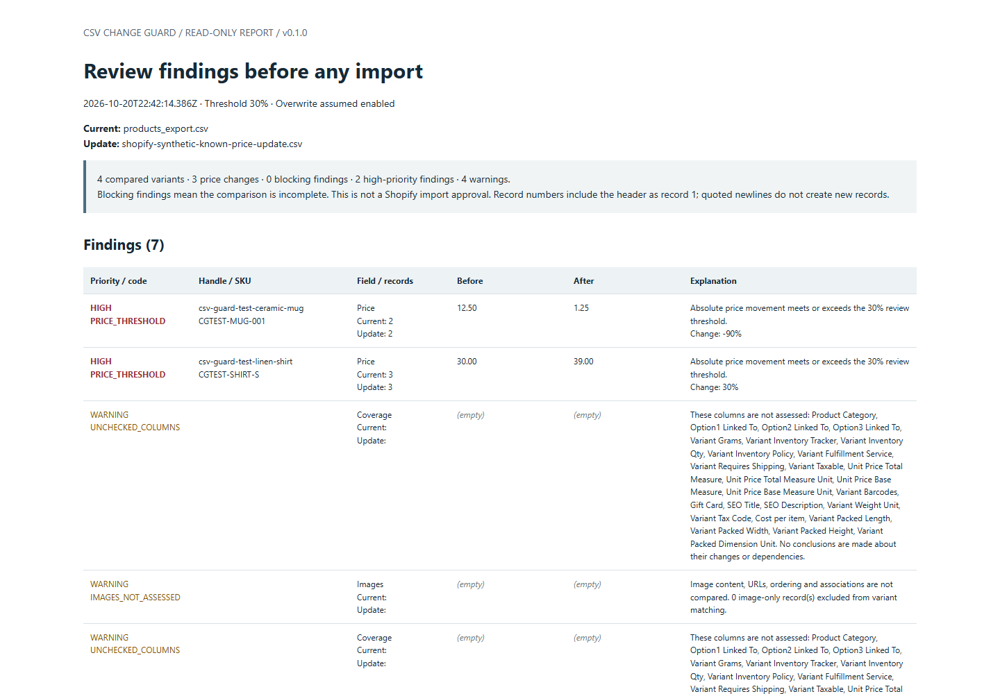

# Standalone report readability fix and validation

On **21 October 2026 (Europe/Warsaw)**, fresh automated installed-Chrome checks
opened the two Shopify synthetic reports after closing the in-app comparison
tab. Their contents passed, but screenshot review found that the long
Explanation column squeezed codes, identifiers and prices into narrow fragments
even at a 1440px desktop width. This was an agent visual review, not a manual
owner usability confirmation.

## Change and scope

The HTML report now gives each of its six columns a defined share of the table
width. On small screens, the table scrolls inside a labeled keyboard-focusable
region while the rest of the page stays within the viewport. Paragraphs and
reference URLs wrap within the page. Print styling removes the minimum table
width and scroll clipping.

Only `reportHTML` presentation changes in `src/engine.js`; `dist/index.html` is
rebuilt from the readable sources. Comparison identity, arithmetic, findings,
HTML escaping, report values, JSON/CSV exports, CSP and sandbox defaults are
unchanged. Old/new engine JSON results, with a shared timestamp, and findings
CSV were asserted identical on both Shopify synthetic pairs. Historical saved
reports retain their old layout; users must generate a new HTML report to get
the presentation update.

The [earlier Chrome screenshot](../test-artifacts/report-layout-2026-10-21/known-price-before.png)
shows the squeezed columns. Coverage warnings still repeat for the two inputs
without an explicit input-source label in each table row; this change does not
redesign the report contents or claim that those warnings are catalog changes.

## Regression contract

The maintained browser runner now has **17 groups**. Its new group generates an
independent two-variant CSV pair with **40 unsupported synthetic columns** and
two price changes, including the supported maximum-length decimal
`999999999999.999999`. It exports the report through the actual application,
closes the comparison context, and opens the report in a fresh context.

The checks verify rendered behavior rather than matching CSS strings:

- At 1440px, all six headers and the full before/after prices occupy one line;
  code, identity and record columns have usable space. Actual widths were
  **156 / 228 / 144 / 168 / 168 / 336px**.
- At 390px, the document fits the viewport. The table keeps its 1120px width
  inside a 342px region; keyboard scrolling works and the full Explanation
  header is reachable. Exact full-range prices remain intact.
- At a 794px print-media viewport, the table fits the page width without a
  clipped scroll region. A PDF is generated. This checks width/clipping and
  PDF creation, not complete multi-page print usability or a visual PDF audit.
- The static report contains no scripts, produces no page errors, and issues no
  unexpected HTTP(S) requests. The one initial app document is allowed in
  localhost mode.

The old application build **fails the new regression**: its columns measured
approximately **43 / 48 / 36 / 42 / 42 / 990px**. The
[expected failure](../test-artifacts/report-layout-2026-10-21/old-regression.json)
is retained. The original 100-finding pagination contract remains unchanged.

The first full development run passed the desktop assertions but failed the
narrow-page check at **398px document width in a 390px viewport**. The offending
elements were the two long rule-reference URLs. Wrapping paragraph/list text
fixed the source issue; the assertion was retained. That
[development failure](../test-artifacts/report-layout-2026-10-21/development-narrow-failure.json)
is separate from the four fresh final runs below.

## Fresh Windows results

The final four-route run was **00:42:14–00:42:56 UTC+02:00**. Tests used the
existing Python **3.14.0** virtual environment and Playwright **1.62.0** on
Windows build **26100**. Browser versions came from the running instances.

| Installed browser | File route | Localhost route |
|---|---|---|
| Chrome 155.0.8059.85 | [17/17 passed](../test-artifacts/report-layout-2026-10-21/chrome-file/browser-test-results.json) | [17/17 passed](../test-artifacts/report-layout-2026-10-21/chrome-localhost/browser-test-results.json) |
| Edge 155.0.4283.62 | [17/17 passed](../test-artifacts/report-layout-2026-10-21/edge-file/browser-test-results.json) | [17/17 passed](../test-artifacts/report-layout-2026-10-21/edge-localhost/browser-test-results.json) |

All four runs used sandboxing. Recorded command lines contain no
`--no-sandbox`; no security settings or policies were changed. Test browser
instances and the dedicated loopback server were stopped afterward. These are
installed-browser automation results, separate from the earlier
[in-app browser comparisons](SHOPIFY_EXPORT_VALIDATION.md) and
[manual owner confirmations](MANUAL_OWNER_VALIDATION.md).

`npm.cmd test` passed **106/106 before and after**; `npm.cmd run build` succeeded.
The local build was **63,494 bytes**; its canonical LF SHA-256 is
`fd4de332375390523ddc50b062d385ee947f457248dc6dff5bec8370f89e7df7`.
The [tested-source hashes](../test-artifacts/report-layout-2026-10-21/tested-sources.json)
identify the modified working tree based on commit `e5d3364`, including Windows
checkout and canonical LF hashes. CI separately verifies the committed build.

The two regenerated Shopify-pair reports were also reopened separately in
fresh sandboxed Chrome contexts after comparison-tab closure:

| Report | Compared | Prices | High | Warnings | Findings |
|---|---:|---:|---:|---:|---:|
| [Unchanged export](../test-artifacts/report-layout-2026-10-21/self-comparison-report.html) | 4 | 0 | 0 | 4 | 4 |
| [Known-price update](../test-artifacts/report-layout-2026-10-21/known-price-comparison-report.html) | 4 | 3 | 2 | 4 | 7 |

Exact values, percentages, settings, filenames, coverage and absence of scripts,
page errors and HTTP(S) requests passed. The
[reopening record](../test-artifacts/report-layout-2026-10-21/shopify-pair-reopening.json)
and [self-report screenshot](../test-artifacts/report-layout-2026-10-21/self-comparison-after.png)
retain those results. This extra Shopify-pair reopening was Chrome only;
Edge's new regression used the independent coverage-heavy fixture.

The [evidence directory](../test-artifacts/report-layout-2026-10-21/) includes
browser results, desktop/narrow/print screenshots, Node logs and a hash manifest.
JSON machine paths are sanitized; images, HTML reports and logs retain their
bytes. No merchant-private files, account screenshots or business-planning
answers are included. No Shopify imports, product publishing or deployment
was performed.

## Reproduction and limits

Run `npm.cmd test`, `npm.cmd run build`, then the existing prepared Python
environment's `tests/browser_test.py --file` and `--url` modes with
`CHROMIUM_PATH` set to installed Chrome or Edge. Keep sandboxing enabled and use
fresh artifact directories. See [CI instructions](CI.md) for setup and localhost
server lifecycle. Explicit `--content` mode remains distinct; it was not rerun
for this change.

This closes the observed desktop column-width defect and adds narrow/print
regressions. Representative merchant usefulness, owner comprehension of the
new Shopify-pair reports, broader performance/accessibility checks and Shopify
import behavior remain separate validation work before a commercial release.
