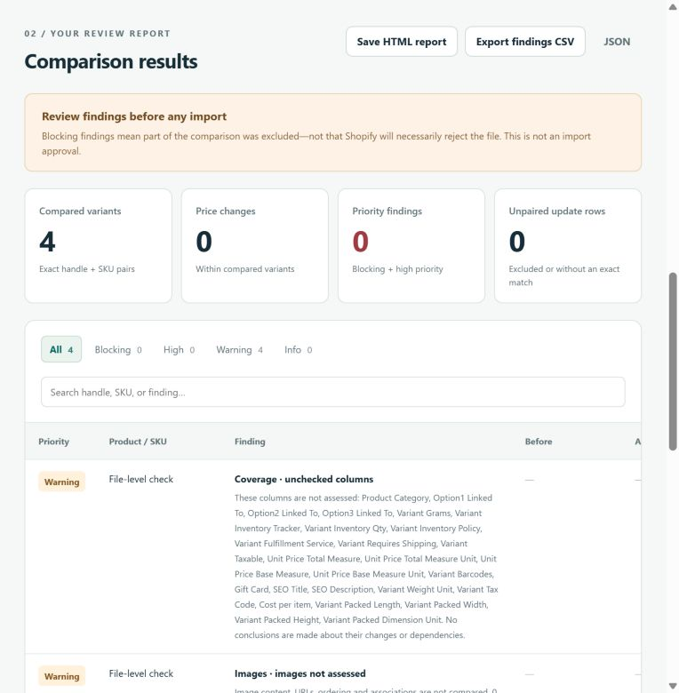
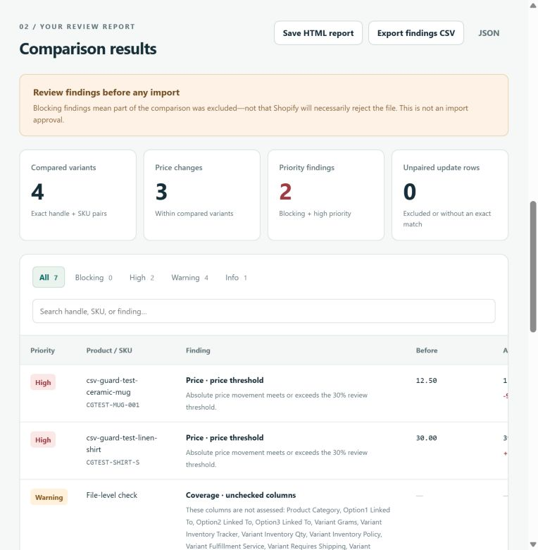

# Shopify-generated synthetic export comparisons

On **21 October 2026 (Europe/Warsaw)**, two comparisons passed in the
**Codex in-app browser** at `http://127.0.0.1:8080/`. The input was a fresh Shopify
export of owner-authorized synthetic Draft products. The agent operated the
comparison controls, inspected the rendered results, captured screenshots and
downloaded reports. The owner manually selected the original file for both
inputs before the first comparison.

This is an agent-operated in-app browser check on the owner's Windows computer,
**not a rerun of installed Chrome or Edge**, the maintained browser suite, or the
earlier guided manual owner smoke test. The in-app browser version and current
Windows build were not captured. No browser security or sandbox setting was
changed, but launch arguments were not captured and sandbox status was not
independently verified in this session. Earlier sandboxed installed-browser
evidence remains in [Windows/Chrome](WINDOWS_VALIDATION.md),
[Windows/Edge](EDGE_VALIDATION.md) and [pagination validation](PAGINATION_VALIDATION.md).

## Inputs and independent expectations

The setup created three clearly labeled synthetic products in the owner's Shopify
store: Ceramic Mug, Linen Shirt with S/M variants, and Tea Tin. They were saved
as Drafts. The export contains **3 handles, 4 variant records and 47 columns**;
the first row for each product has `Status=draft` and `Published=false`. This is
Shopify-generated synthetic data, not a representative merchant catalog or the
[public Shopify template](SHOPIFY_SAMPLE_VALIDATION.md).

The downloaded `products_export.csv` is preserved as
[`shopify-synthetic-catalog.csv`](../test-artifacts/shopify-export-2026-10-21/shopify-synthetic-catalog.csv).
Its **1,991 bytes** have SHA-256:

```text
d0c28f8754de35ebad6012a9209570712780c4bf8d49a2f9677b851eb83dd1e7
```

Strict CSV checks confirmed UTF-8, unique handle/SKU keys, all four expected
prices/options, synthetic descriptions, quoted comma/quote text, and `Żółty`,
`日本語`, and `café`. The second shirt variant has populated SKU, price and option
value but blank product-level fields and Option1 name, exercising Shopify's
continuation format. No false clearing or option-name findings appeared.

A separate local
[`shopify-synthetic-known-price-update.csv`](../test-artifacts/shopify-export-2026-10-21/shopify-synthetic-known-price-update.csv)
changes exactly three price cells. Parsing and comparing all cells confirmed
that the other field values were preserved, including the M variant's price.
These expected changes were specified before running the comparisons:

| Synthetic SKU | Original price | Local update | Expected finding at 30% |
|---|---:|---:|---|
| `CGTEST-MUG-001` | 12.50 | 1.25 | −90%, high `PRICE_THRESHOLD` |
| `CGTEST-SHIRT-S` | 30.00 | 39.00 | +30%, high `PRICE_THRESHOLD`, inclusive boundary |
| `CGTEST-SHIRT-M` | 30.00 | 30.00 | No change finding |
| `CGTEST-TEA-001` | 15.00 | 16.50 | +10%, informational `PRICE_CHANGED` |

The Shopify product editor displayed PLN. The CSV does not encode a currency;
CSV Change Guard did not infer one. Neither file was imported into Shopify.

## Observed browser results

Both comparisons used **threshold 30%** and **overwrite enabled**. Their verdict
was **“Review findings before any import”**. There were no blocking findings,
unpaired update rows, invalid records or image-only records in either comparison.

| Comparison | Compared | Price changes | Priority findings | Warnings | Info | Total findings |
|---|---:|---:|---:|---:|---:|---:|
| Export against itself | 4 | 0 | 0 | 4 | 0 | 4 |
| Export against known price update | 4 | 3 | 2 | 4 | 1 | 7 |

The four warnings are two `UNCHECKED_COLUMNS` and two `IMAGES_NOT_ASSESSED`
findings, one of each per input. The export includes **26 unsupported columns**
per file. These are coverage disclosures, not claims that catalog values changed
or that image contents were checked. The three price findings matched the exact
SKUs, before/after values, percentages, codes and severities above. The unchanged
M variant had no change finding.





The screenshots preserve the narrow in-app viewport. Some right-hand table cells
are outside the captured view; exact values were checked in the rendered DOM
and downloaded reports, not inferred from the cropped table cells.

## Evidence and verification boundaries

- [Browser run record](../test-artifacts/shopify-export-2026-10-21/browser-validation.json):
  records the manual initial file selection, subsequent agent UI actions,
  observations, environment limits and checks not rerun. Its UTC verification
  timestamp `2026-10-20T22:16:24.798Z` is **21 October, 00:16:24.798 UTC+02:00**
  in Europe/Warsaw.
- Browser-generated HTML reports for the
  [self-comparison](../test-artifacts/shopify-export-2026-10-21/browser-self-comparison-report.html)
  and [known update](../test-artifacts/shopify-export-2026-10-21/browser-known-price-comparison-report.html),
  plus the [known-update JSON download](../test-artifacts/shopify-export-2026-10-21/browser-known-price-comparison-report.json).
  Node strict assertions verified the self-report counts and warning codes,
  and the JSON's settings, exact identities/values, percentages, severities and
  counts against the independent expectations. The HTML reports were **saved and
  content-checked, not reopened in a fresh browser context** during this run.
- Rendered DOM captures for the
  [self-comparison](../test-artifacts/shopify-export-2026-10-21/browser-self-comparison-dom.txt)
  and [known update](../test-artifacts/shopify-export-2026-10-21/browser-known-price-comparison-dom.txt)
  preserve the visible labels, counters and all four/seven findings.
- [Earlier engine checks](../test-artifacts/shopify-export-2026-10-21/engine-validation.json)
  independently exercised the same pairs through Node. They are **engine-only
  evidence**, not browser results. The first check incorrectly expected only
  the two image warnings and failed at four warnings. Inspecting the findings
  and source identified the two unsupported-column warnings; the corrected
  checks assert both codes and their current/update sources. No app fix was made.
- [Artifact manifest](../test-artifacts/shopify-export-2026-10-21/artifact-manifest.json):
  hashes and sizes of the evidence. Inputs, downloaded reports, DOM captures and
  screenshots retain their captured bytes. Summary metadata is curated to label
  scope and omit private machine paths; no account screenshots or credentials
  are included. The evidence directory's `.gitattributes` preserves those bytes
  across Windows Git line-ending conversion.

Repository context was commit
[`d8523c4`](https://github.com/DemonazGH/csv-change-guard/commit/d8523c4cbd6c7e10b0d99a449fcf6abc116fd35f).
The checkout's standalone bundle SHA-256 was
`6671736080fde8ccf9c1e2225c49c3a787f6fc51b435ef21c5d9d2cfe10e5f54`.
These identify the local checkout context; a hash of the document served to the
browser was not captured. The documentation update leaves application sources,
bundle, fixtures under `samples/`, maintained tests, dependencies and CI unchanged.
[`npm.cmd test` passed 106/106](../test-artifacts/shopify-export-2026-10-21/docs-update-engine-tests.txt)
while preparing this documentation update, using installed Node **24.12.0** and
npm **11.6.2**. No rebuild was needed for documentation and evidence only.

## Setup restrictions and reproduction

The browser tool could not observe the open Edge `file://` page because its URL
policy allowed HTTP(S) only. Automated Edge file selection also required an
extension permission that was not enabled. The owner opened the documented
localhost route and selected the file in the **in-app browser**. An unused Edge
localhost tab still had no files selected. The agent eventually located the
populated in-app tab and verified both filenames/settings before comparing.
These setup restrictions are not successful Edge checks or app defects.

To repeat the two comparisons, run `npm.cmd run dev` from the checkout and open
its printed localhost address. Select the preserved baseline for both inputs,
compare at 30% with overwrite enabled, and check the first row of the results
table above. Then leave the baseline selected, choose the known-price update
for Proposed update, compare again, and verify the second row and exact price
findings. Record the browser surface/version and actual file-selection method.
Leave sandboxing and security settings enabled; record unavailable checks as
blocked. Do not enable broader extension permissions merely to reproduce this run.

## Remaining gaps and next small check

The START_HERE demo/sample/clear workflow, maintained 16-group suite, and installed
Chrome/Edge checks were **not rerun for this export pair**. Earlier results retain
their own dates and scope. This session also did not measure network traffic,
retest every export format, or provide a fresh independent owner usability verdict.

Next, reopen these two saved HTML reports manually after closing the comparison
tab and record whether the synthetic identities, values, settings and coverage
make sense on their own. Fresh installed-browser checks with this pair, more
representative authorized workflows and controlled Shopify import round trips
remain separate tasks. CSV Change Guard itself remains local and read-only;
the synthetic store setup did not add a store connection to the app. No import,
product publishing, billing change or product deployment was performed.
