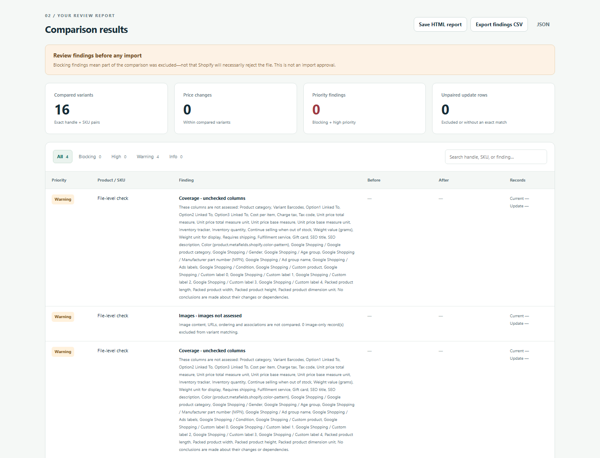

# Official Shopify sample compatibility

On **18 October 2026**, the two compatibility fixes from the Downloads copy were
ported onto repository base `efa88c7`. The official sample was downloaded again
and compared with itself before and after the change. Fresh Windows/Chrome
browser checks ran at **23:32:19–23:32:50 Europe/Warsaw (UTC+02:00)** against the
rebuilt working tree. Engine and build hashes identify that tested version in
the [run summary](../test-artifacts/shopify-compatibility-2026-10-18/run-summary.json).

## Source and bounded behavior

Shopify links its [public product CSV template](https://help.shopify.com/cdn/shopifycloud/product-knowledge/production/csv/product_template.csv)
from [Using CSV files to import and export products](https://help.shopify.com/en/manual/products/import-export/using-csv).
The sample downloaded for this run had **6,536 bytes, 61 columns and 16 variant
records across 3 handles**. Its SHA-256 was:

```text
f41b9562b9d9d951ff8f8184f7fe24e738304339d3e24104fc5c265fa00d28ff
```

The column reference documents `active`, `draft` and `archived`. The template
also uses the exact spelling `Active`. It leaves option-name cells blank on
later variant rows whose first product row supplies the name. These observations
support two narrow compatibility rules:

- Treat exactly `Active` as equivalent to `active` for status validation,
  product-field consistency and comparisons. Preserve original text in genuine
  status-change findings and exports. Do not trim or accept arbitrary casing.
- For Option1/2/3 names only, resolve an explicitly empty continuation cell from
  the clear first product row of the same handle in the same input file. Compare
  and report those effective names. Never inherit option values, fill omitted
  columns, overwrite populated names, or take names from another product/file.

Handle + nonempty SKU identity, exact monetary arithmetic, product-field
ambiguity handling, image exclusions and overwrite assumptions are unchanged.
This does not establish Shopify's importer identity rules or full import
compatibility. See also Shopify's [import and overwrite guidance](https://help.shopify.com/en/manual/products/import-export/import-products).

The public CSV itself remains in ignored `.local-test-artifacts/`, outside the
committed fixtures. All new regression data is independently constructed
synthetic data; CI does not download or depend on the public template.

## Before and after

Both runs compared all **16 variants**, with **zero unpaired update rows and
zero price changes**. The [recorded comparison](../test-artifacts/shopify-compatibility-2026-10-18/sample-comparison.json)
shows:

| Finding code | Before | After |
|---|---:|---:|
| `INVALID_STATUS` | 2 blocking | 0 |
| `OPTION_PAIR_INCOMPLETE` | 24 high | 0 |
| `UNCHECKED_COLUMNS` | 2 warnings | 2 warnings |
| `IMAGES_NOT_ASSESSED` | 2 warnings | 2 warnings |

The resulting report contains **four coverage warnings and no changes,
blocking findings, high-priority findings or informational findings**. The
warnings remain meaningful: images and unsupported fields were not assessed.
The verdict remains “Review findings before any import,” not an import approval.

## Regression and Windows checks

| Check | Fresh result |
|---|---|
| New Node regressions against the old engine | 9 of 14 failed; the original 92 tests and 5 added guard cases passed ([before log](../test-artifacts/shopify-compatibility-2026-10-18/regressions-before-fix.txt)) |
| Engine/scenario suite after the fix | **106 passed**, 0 failed/cancelled/skipped: 94 engine + 12 scenario tests ([after log](../test-artifacts/shopify-compatibility-2026-10-18/engine-tests.txt)) |
| Browser suite through actual `file://` navigation | **15/15 groups passed** ([result](../test-artifacts/shopify-compatibility-2026-10-18/browser/file-20261018T213221820720Z-b3e9369d/browser-test-results.json)) |
| Browser suite through actual localhost navigation | **15/15 groups passed** ([result](../test-artifacts/shopify-compatibility-2026-10-18/browser/url-20261018T213228195677Z-442f6f18/browser-test-results.json)) |
| Actual official sample selected in Chrome, file and localhost modes | Both produced **16 compared, 0 prices, 0 priority, 0 unpaired, 4 warnings** ([file](../test-artifacts/shopify-compatibility-2026-10-18/official-file/result.json), [localhost](../test-artifacts/shopify-compatibility-2026-10-18/official-localhost/result.json)) |
| Download and open official-sample HTML report | Passed through `file://` after closing the app tab, from both launch routes; 4 rows, no scripts |
| START_HERE functional workflow and nine linked synthetic scenarios | Passed; demo/sample counts remained **4 / 4 / 6 / 4 / 15** ([workflow result](../test-artifacts/shopify-compatibility-2026-10-18/start-here/workflow-results.json)) |
| Rebuild | Succeeded; canonical LF bundle is **62,650 bytes**, matching the Downloads copy's implementation |

The new browser group uses synthetic files to exercise the `Active` alias and
blank continuation name together, then changes an option value and verifies that
the high-priority finding remains. The 14 Node regressions cover all three
options, header aliases, reordered variants, interleaved image rows, isolation
between handles/files, missing/omitted/whitespace names, missing values, unclear
first rows, status conflicts and preservation of genuine changes in exports.

Runtime: **Windows 11 Enterprise LTSC Evaluation, build 26100; installed Chrome
155.0.8059.80; Python 3.14.0; Playwright 1.62.0; Node v24.12.0**. Every Chrome
launch used sandboxing, separate temporary profiles and normal navigation.
Captured launch arguments confirm no `--no-sandbox`; no browser policies or
persistent settings were changed. Browser instances and the loopback server
were stopped afterward.

No JavaScript page errors or application HTTP(S) requests were observed beyond
the one initial document request per localhost launch. No store connection,
merchant data, import, payment or deployment was used. The official sample was
retrieved separately by the test setup; the app made no download/upload request.

Windows source files have mixed checkout line endings. The rebuilt test file
was 62,806 bytes; its canonical LF form is 62,650 bytes with SHA-256:

```text
442fdf33fb9c89d147920090cca7c63d411e30119c744ab2ebb32bcd7c3eb0c1
```

Git normalizes the committed application files to LF. CI verifies that the
committed bundle matches a fresh build from those sources. Only `src/engine.js`
and the regenerated bundle change application behavior; the UI sources,
fixtures, dependencies and CI workflow are unchanged.

## Screenshots and reproduction



- [Official-sample report opened independently](../test-artifacts/shopify-compatibility-2026-10-18/official-file/official-sample-report-open.png).
- [Official sample through localhost](../test-artifacts/shopify-compatibility-2026-10-18/official-localhost/official-sample-results.png).
- [Built-in demo](../test-artifacts/shopify-compatibility-2026-10-18/start-here/demo-results.png), [selected samples](../test-artifacts/shopify-compatibility-2026-10-18/start-here/sample-results.png), [cleared state](../test-artifacts/shopify-compatibility-2026-10-18/start-here/cleared-after-samples.png).
- [390px layout](../test-artifacts/shopify-compatibility-2026-10-18/browser/file-20261018T213221820720Z-b3e9369d/mobile.png).

The [dated evidence directory](../test-artifacts/shopify-compatibility-2026-10-18/)
contains all fresh results, 27 screenshots, exports, source metadata, normalized
script snapshots and an artifact hash manifest. Machine-specific metadata paths
are replaced with placeholders; screenshots and exports retain their bytes.
The official report's long coverage messages make its narrow table columns wrap
heavily. Counts, warnings and limitations remain present; that existing layout
issue is separate from this compatibility change.

For a new run, install `tests/requirements-browser.txt` in a virtual environment,
set `CHROMIUM_PATH` to installed Chrome, run `npm.cmd test` and `npm.cmd run build`,
then run `python tests/browser_test.py --file` and the default localhost mode
with `node server.cjs` running. Keep sandboxing enabled and use fresh artifacts.
To check the public template, retrieve it outside tracked fixtures, record its
hash, and select the same unchanged file for both inputs. A changed public
template requires a new expected-results review.

Manual owner usability, Explorer/file-dialog interaction, Edge, real merchant
workflows and controlled Shopify imports remain separate validation tasks.
